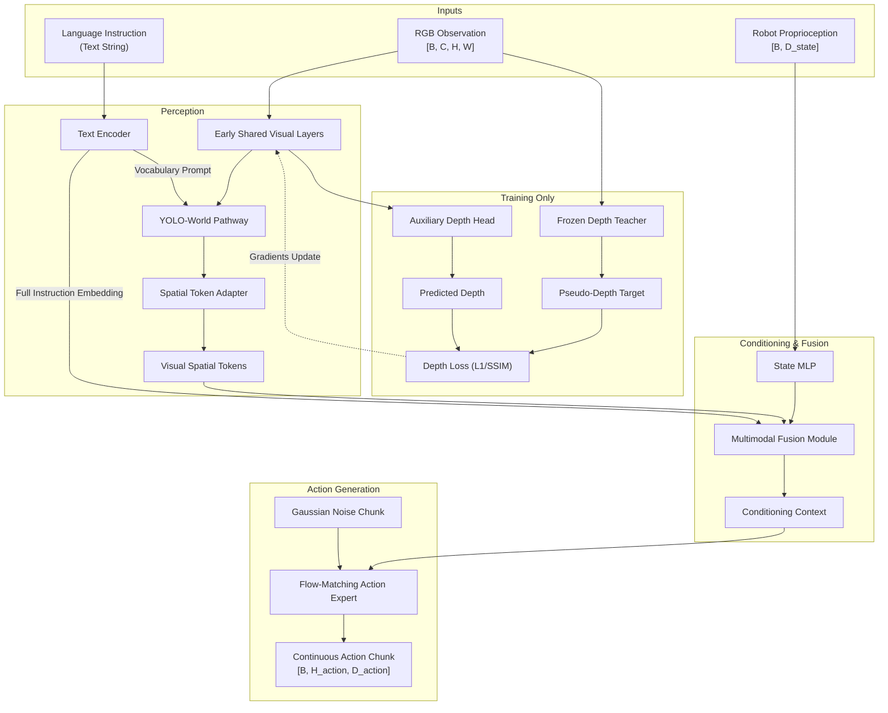

# Architecture Specification (v2): Compact Language-Conditioned Robot Policy

**Status:** Architecture Proposal & Specification (Pending source inspection and review)
**Target Domain:** Real-time robot manipulation (Initial benchmark: LIBERO-Object)
**Deployment Target:** Standalone edge inference on NVIDIA Jetson Orin Nano / Kaggle GPU training

---

## 1. High-Level Concept & Design Rationale

Architecture v2 shifts the design from an LLM-backbone vision-language-action model (SmolVLA) to an ultra-compact, high-frequency, task-specific policy. The rationale rests on three pillars:
1. **Perception Grounded in Open-Vocabulary Detection:** Leveraging pretrained YOLO-World representations provides object-centric visual features without carrying multi-billion parameter autoregressive decoders.
2. **Direct Instruction Conditioning:** Text instructions serve a dual purpose: (a) conditioning the open-vocabulary visual encoder, and (b) feeding a complete instruction embedding directly into the fusion module so policy decisions retain holistic task context.
3. **Implicit 3D Geometry via Training-Only Pseudo-Depth:** Physical robot interaction relies heavily on spatial geometry. Rather than requiring active depth cameras at deployment, a frozen state-of-the-art depth teacher provides dense pseudo-depth targets during training. An auxiliary depth head updates early shared visual features, transferring geometric awareness into RGB features at zero runtime cost.

---

## 2. Component Breakdown

### 2.1 Visual Pathway: Pretrained YOLO-World
- **Input:** RGB image tensor preprocessed to standard resolution (e.g. 512×512 or 640×640).
- **Core Encoder:** Pretrained YOLO-World backbone and neck.
- **Text Conditioning:** YOLO-World's text cross-attention or prompt-driven conditioning layers highlight task-relevant entities in visual space.
- **Spatial Token Adapter:** Multi-scale feature taps are pooled and projected into a sequence of discrete spatial visual tokens.

### 2.2 Dual Language Representation
- **Path 1 (Object Vocabulary Conditioning):** Instruction tokens or extracted candidate labels configure the open-vocabulary detection pathway in YOLO-World.
- **Path 2 (Complete Instruction Fusion):** The holistic instruction embedding (e.g., pooled sentence representation) is projected directly into the multimodal fusion module, preserving semantic nuances (e.g., relations, verbs, spatial prepositions like "left of", "inside") that vocabulary bounding boxes may omit.

### 2.3 Robot State MLP
- Proprioceptive sensor inputs (joint angles, end-effector pose, gripper open/closed state) are normalized and mapped through a lightweight MLP into the fusion embedding dimension.

### 2.4 Multimodal Fusion
- Integrates visual spatial tokens, the complete instruction embedding, and the projected state vector.
- Architectural candidates for fusion include cross-attention, concatenated self-attention blocks, or gated cross-attention conditioning.

### 2.5 Action Generation: Flow Matching
- **Action-Generation Method:** Flow matching is the initial action-generation mechanism, following empirical successes in openpi, pi0, and LeRobot SmolVLA.
- Generates continuous multi-step action trajectories (action chunks) by numerically integrating a vector field from noise $\epsilon \sim \mathcal{N}(0, I)$ toward the target action distribution over $K$ Euler steps.

---

## 3. Auxiliary Depth Supervision: Principles & Mechanics

### Teacher Pseudo-Depth vs. Measured Ground Truth
- In real-world manipulation datasets (and many simulated suites like LIBERO), measured physical depth channels are either noisy, missing, calibration-sensitive, or completely absent.
- **Approach:** A frozen high-quality monocular depth estimation teacher (e.g., Depth Anything v2 or Metric3D) generates dense pseudo-depth maps offline or online during training.
- **Zero Deployment Cost:** The teacher runs strictly during training. Neither depth sensors nor the teacher model are required on the robot at test time.

### Shared-Gradient Requirement
- The auxiliary depth head must branch from the visual pathway **before** language conditioning layers and must share low- and mid-level feature representations.
- **Loss Backpropagation:** Depth loss gradients $\nabla_{\theta_{shared}} \mathcal{L}_{depth}$ directly update the early visual backbone parameters $\theta_{shared}$.
- This forces the early convolutional/transformer visual layers to retain 3D metric and edge geometry, counteracting the tendency of pure 2D detection backbones to collapse depth information.

---

## 4. Training Objectives & Loss Formulation

The total training loss combines continuous action generation and geometric regularization:

$$\mathcal{L}_{total} = \mathcal{L}_{action} + \lambda_{depth} \mathcal{L}_{depth}$$

1. **Action Flow-Matching Loss ($\mathcal{L}_{action}$):**
   $$\mathcal{L}_{action} = \mathbb{E}_{t, x_0, x_1} \left\| v_\theta(x_t, t, c) - u_t \right\|^2$$
   where $x_1$ is target action chunk, $x_0 \sim \mathcal{N}(0, I)$, $t \in [0, 1]$, $x_t = (1 - t)x_1 + t x_0$, target velocity $u_t = x_0 - x_1$, and $c$ is the fused conditioning context.
2. **Auxiliary Depth Loss ($\mathcal{L}_{depth}$):**
   Combines scale-invariant depth regression with edge-preserving losses:
   $$\mathcal{L}_{depth} = \alpha \mathcal{L}_{L1}(D_{pred}, D_{teacher}) + \beta \mathcal{L}_{SSIM}(D_{pred}, D_{teacher})$$

---

## 5. Unresolved Implementation Decisions

To avoid speculative lock-in ahead of source inspection, the following parameters remain explicitly open and will be decided based on empirical inspection of YOLO-World repositories and benchmark data:

| Parameter / Decision | Candidate Options | Resolution Strategy |
|---|---|---|
| **YOLO-World Checkpoint & Source** | Ultralytics YOLO-World (v8/v11) vs. mmdetection/official YOLO-World repo | Inspect license, module extractability, export compatibility, and PyTorch cleanly-isolated forward execution. |
| **YOLO-World Feature Taps** | Multi-scale backbone taps (P3, P4, P5) vs. neck cross-modal taps | Verify spatial resolution and channel dimensions after language fusion layers. |
| **Feature Extraction Channels** | Unconfirmed (depends on YOLO-World scale: S, M, L) | Do not assume fixed channel counts (e.g., 128/256) until the exact checkpoint is chosen. |
| **Language Representation** | CLIP text encoder vs. ModernBERT vs. T5/DistilBERT | Evaluate parameter count, inference latency, and sentence-level representation quality. |
| **Visual Token Budget** | 64 vs. 128 vs. 256 tokens per camera | Profile latency on Jetson Orin Nano against spatial resolution needs on LIBERO. |
| **Multimodal Fusion Dimension** | 384 vs. 512 vs. 768 | Balance policy expressive capacity against Orin Nano memory bandwidth. |
| **Action Chunk Horizon ($H_{action}$)** | 10 to 50 steps | Benchmark action horizon vs. control frequency on LIBERO-Object. |
| **Observation History** | Single frame ($T=1$) vs. multi-step history ($T=2, 3$) | Confirm dataset format support in LIBERO and LeRobot dataset loaders. |
| **Dependency Stack & Versions** | PyTorch 2.x, Ultralytics, HuggingFace Hub | Validate compatibility on Kaggle GPU runners before freezing. |
