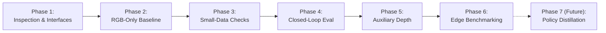

# Development Plan: Language-Conditioned YOLO-World Robot Policy

**Scope:** Step-by-step roadmap from perception module design to Kaggle training, closed-loop evaluation, and Jetson deployment.
**Guiding Principle:** Progressive validation through incremental, verifiable phases. No speculative premature commitments.

---

## Phase Overview

---

## Phase 1: Source Inspection & Clean Interface Definition

### Goals
- Perform exhaustive source inspection of candidate YOLO-World implementations (Ultralytics vs. official repository).
- Determine exact submodule structure, text prompt feeding mechanics, and visual-language cross-attention hook points.
- Verify LIBERO-Object dataset format, camera resolutions, state dimension, action space, and normalization statistics.
- Define clean Python abstract base classes and typed contracts across the 7 subpackages (`vision`, `language`, `fusion`, `policy`, `depth`, `data`, `training`, `evaluation`).

### Deliverables
- `reports/yolo_world_source_inspection.md` with verified symbol tables and tensor dimensions.
- Concrete interface definitions in `src/smol_vla_mod/`.

---

## Phase 2: RGB-Only Policy Implementation

### Goals
- Implement the perception pathway: YOLO-World backbone extraction + spatial token adapter.
- Implement text encoding: generating both YOLO-World vocabulary conditioning and the complete sentence embedding.
- Implement state embedding MLP.
- Implement the multimodal fusion module (cross-attention or transformer encoder blocks).
- Implement the flow-matching continuous action head (Euler ODE solver and velocity field MLP).
- Assemble the complete end-to-end forward pass without depth heads.

### Deliverables
- Modular unit tests validating shapes, device compatibility, and parameter freezing/unfreezing.
- Single-batch forward and backward pass verified on synthetic tensors on Kaggle.

---

## Phase 3: Small-Data Learning & Overfitting Checks

### Goals
- Test policy learning capacity by training on a tiny subset (e.g. 1 to 5 demonstrations of a single LIBERO-Object task) on Kaggle.
- Confirm that the flow-matching loss decreases monotonically and that the policy memorizes demonstration actions.
- Verify gradient propagation into trainable perception and fusion layers while keeping desired backbone layers frozen.
- Validate loss logging, checkpoint serialization, and reproducible seeding.

### Deliverables
- Training curves showing successful overfitting on 1–5 episodes.
- Verified checkpoint save/load harness in `src/smol_vla_mod/training/`.

---

## Phase 4: Closed-Loop Simulation Evaluation (RGB Baseline)

### Goals
- Set up a closed-loop rollout environment on Kaggle for LIBERO-Object.
- Evaluate the trained RGB-only policy across benchmark task suites (success rate, completion time, trajectory smoothness).
- Benchmark against upstream SmolVLA baseline (`lerobot/smolvla_base`) on the same task distributions.

### Deliverables
- Evaluation report with empirical success rates on LIBERO-Object.
- Rollout videos and trajectory analysis.

---

## Phase 5: Auxiliary Depth Experimentation

### Goals
- Integrate the auxiliary depth head branching from shared early visual layers.
- Select and configure the frozen depth teacher (e.g., Depth Anything v2).
- Pre-generate or stream pseudo-depth targets on LIBERO-Object training data.
- Train the policy under joint loss: $\mathcal{L}_{total} = \mathcal{L}_{action} + \lambda_{depth} \mathcal{L}_{depth}$.
- Conduct paired ablation: evaluate whether depth-regularized visual representations improve closed-loop manipulation success and sample efficiency over the RGB-only baseline.

### Deliverables
- Ablation report: RGB-only vs. RGB + Auxiliary Depth on LIBERO-Object.
- Analysis of gradient norms across shared visual layers.

---

## Phase 6: Edge Efficiency Benchmarking & Deployment Preparation

### Goals
- Detach the auxiliary depth head and depth teacher entirely.
- Export policy inference pathway to ONNX and compile with TensorRT for NVIDIA Jetson Orin Nano.
- Profile end-to-end inference latency, throughput (FPS), peak VRAM, and power draw across:
  - Local workstation CPU / Quadro T2000
  - Kaggle GPU
  - Jetson Orin Nano (target 30+ Hz control loop)

### Deliverables
- Benchmarking report with hardware profiling tables (latency, memory, throughput).
- Deployment runner scripts in `scripts/deploy/`.

---

## Phase 7 (Later Experiment): Policy Distillation from Foundation Teachers

### Goals
- Investigate whether the compact YOLO-World policy can be further improved by distilling trajectory representations or feature maps from larger foundation models (e.g., SmolVLA or OpenVLA).
- Explore action chunk distribution matching and intermediate feature imitation.

### Deliverables
- Distillation methodology report and comparative benchmark.
