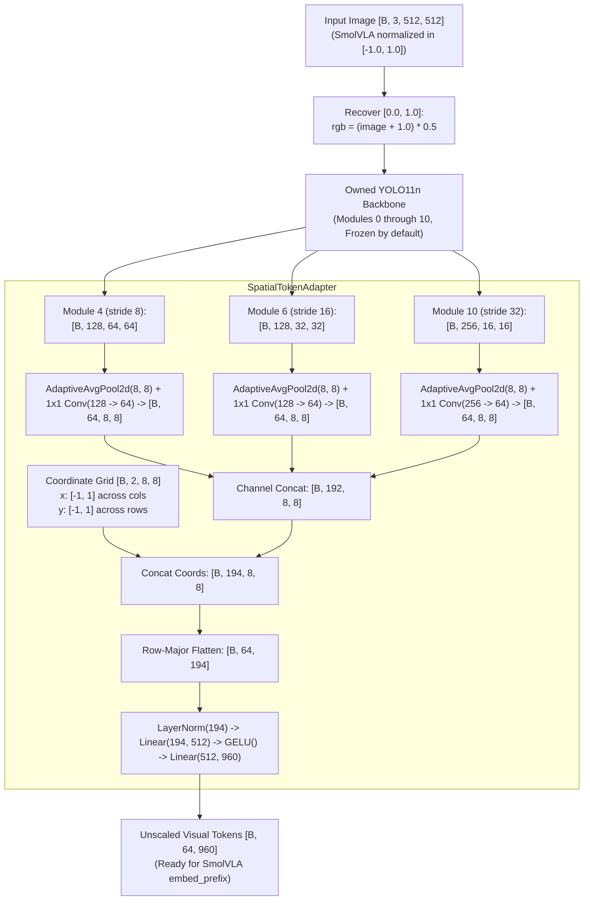

# YOLO Visual Tokenizer Architecture & Integration Specification (v1)

**Status:** Historical / Phase 1 Reference (Preserved)
**Context Note:** This document describes the earlier SmolVLA visual encoder-replacement experiment (YOLO11n tokenizer with retained SmolVLM language backbone). It is preserved as a historical baseline design and does not describe the new YOLO-World policy architecture (v2).
**Revision Reference:** LeRobot upstream commit `d3793b7e36522321c1c455f0dc4826db3793dceb`
**Primary Modules:**
- `SpatialTokenAdapter` in [yolo_tokenizer.py](file:///home/abolarinwa-sa/Documents/Smol-VLAxYOLO/src/smol_vla_mod/vision/yolo_tokenizer.py#L46)
- `YoloVisualTokenizer` in [yolo_tokenizer.py](file:///home/abolarinwa-sa/Documents/Smol-VLAxYOLO/src/smol_vla_mod/vision/yolo_tokenizer.py#L198)

> [!NOTE]
> **Historical Artifact Notice:** As part of the Architecture v2 overhaul, this module is maintained as an uncoupled baseline reference. The primary policy architecture now centers on a lightweight language-conditioned policy using a YOLO-World visual pathway, direct instruction embedding fusion, auxiliary depth supervision, and flow matching action chunks without an LLM backbone. See [architecture_v2.md](file:///home/abolarinwa-sa/Documents/Smol-VLAxYOLO/docs/architecture_v2.md).

---

## 1. Architecture Overview & Exact Tensor Shapes

The YOLO visual tokenizer provides a drop-in visual encoding replacement for SmolVLA that extracts multi-scale spatial representations from a YOLO11n backbone and maps them to a fixed sequence of visual tokens.



### Detailed Tensor Transformations

| Stage | Input Shape | Transformation | Output Shape | Notes |
|---|---|---|---|---|
| **Input Image** | `[B, 3, 512, 512]` | None | `[B, 3, 512, 512]` | From SmolVLA `prepare_images` in `[-1.0, 1.0]`. |
| **Pixel Recovery** | `[B, 3, 512, 512]` | `rgb = (image + 1.0) * 0.5` | `[B, 3, 512, 512]` | Maps to `[0.0, 1.0]`. No clamping, no letterbox, no RGB/BGR conversion. |
| **Backbone Module 4** | `[B, 3, 512, 512]` | Modules 0..4 | `[B, 128, 64, 64]` | Fine feature map (stride 8). |
| **Backbone Module 6** | `[B, 128, 64, 64]` | Modules 5..6 | `[B, 128, 32, 32]` | Mid feature map (stride 16). |
| **Backbone Module 10** | `[B, 128, 32, 32]` | Modules 7..10 | `[B, 256, 16, 16]` | Coarse feature map (stride 32). |
| **Adaptive Pool** | 3 feature maps | `AdaptiveAvgPool2d((8, 8))` | 3x `[B, C_i, 8, 8]` | Uniform spatial grid of `8x8`. |
| **1x1 Conv Proj** | 3 pooled maps | `Conv2d(C_i, 64, 1)` | 3x `[B, 64, 8, 8]` | Dedicated trainable 1x1 projection per scale. |
| **Feature Concat** | 3 projected maps | `torch.cat(dim=1)` | `[B, 192, 8, 8]` | $3 \times 64 = 192$ channels. |
| **Coordinate Grid** | Dynamic grid | Linspace meshgrid `[-1, 1]` | `[B, 2, 8, 8]` | Channel 0: $x$ (varies across cols). Channel 1: $y$ (varies across rows). |
| **Coord Concat** | Features + Coords | `torch.cat(dim=1)` | `[B, 194, 8, 8]` | $192 + 2 = 194$ channels. |
| **Spatial Flatten** | `[B, 194, 8, 8]` | `permute(0, 2, 3, 1).reshape(B, 64, 194)` | `[B, 64, 194]` | Strictly row-major order ($t = h \cdot W + w$). |
| **MLP Projection** | `[B, 64, 194]` | `LN(194) -> Linear(512) -> GELU -> Linear(960)` | `[B, 64, 960]` | Production target: 64 tokens of width 960 per camera. |

---

## 2. Integration Boundary: `SmolVLMWithExpertModel.embed_image()`

### Upstream Baseline
In upstream LeRobot (`src/lerobot/policies/smolvla/smolvlm_with_expert.py:202-215`):
```python
def embed_image(self, image: torch.Tensor):
    patch_attention_mask = None
    # Vision encoder forward pass
    image_hidden_states = (
        self.get_vlm_model()
        .vision_model(
            pixel_values=image.to(dtype=self.get_vlm_model().vision_model.dtype),
            patch_attention_mask=patch_attention_mask,
        )
        .last_hidden_state
    )
    # Modality projection & resampling
    image_hidden_states = self.get_vlm_model().connector(image_hidden_states)
    return image_hidden_states
```

### YOLO Variant Integration
When integrating YOLO into the full policy, the integration hook replaces `embed_image()`:
```python
def embed_image(self, image: torch.Tensor):
    # image is [B, 3, 512, 512] normalized in [-1.0, 1.0] by SmolVLAPolicy.prepare_images
    return self.yolo_tokenizer(image)
```

### Connector Bypass
The original SigLIP vision transformer and the SmolVLM visual connector (`connector`) are completely bypassed. `SpatialTokenAdapter` acts as both spatial token resampler and modality projector, directly outputting embeddings in the language backbone's hidden dimension (`960`).

---

## 3. Scaling and Normalisation Invariants

### Unscaled Output
`SpatialTokenAdapter` returns raw, unscaled tokens of shape `[B, 64, 960]`. It explicitly omits:
- Output LayerNorm
- L2 normalisation
- $\sqrt{D}$ scaling ($\sqrt{960}$)

SmolVLA handles embedding normalization uniformly in `VLAFlowMatching.embed_prefix` (`modeling_smolvla.py:636-639`):
```python
img_emb_dim = img_emb.shape[-1]
img_emb = img_emb * torch.tensor(img_emb_dim**0.5, dtype=img_emb.dtype, device=img_emb.device)
```
Leaving the tokens unscaled preserves exact compatibility with SmolVLA's existing scaling convention.

---

## 4. Parameter Freezing & Gradient Flow Contract

1. **Backbone Isolation:**
   - Backbone parameters are frozen by default (`requires_grad=False`).
   - `self.backbone.eval()` is enforced, locking `nn.BatchNorm2d` running statistics even during `tokenizer.train()`.
   - `unfreeze_backbone()` and `freeze_backbone()` provide explicit control for multi-phase training.
2. **Trainable Adapter:**
   - `SpatialTokenAdapter` parameters remain fully trainable throughout alignment.
3. **Downstream Gradient Flow:**
   > [!IMPORTANT]
   > Freezing the YOLO backbone **does not** justify wrapping the downstream language backbone or action expert in `torch.no_grad()` during policy training. Gradients computed by the flow-matching loss must propagate back through the action expert, cross-attention layers, language prefix embeddings, and into the `SpatialTokenAdapter`.

---

## 5. Weight Handling & Validation Strategy

- **No Implicit Downloads:** Constructing `YoloVisualTokenizer` does not download model weights from the Hugging Face Hub or Ultralytics servers.
- **Architectural Tests:** Unit tests instantiate YOLO11n from its packaged YAML definition (`DetectionModel(cfg="yolo11n.yaml")`) or use a synthetic PyTorch mock with identical topology.
- **Pretrained Weights:** Pretrained checkpoint loading (`yolo11n.pt`) is deferred to Kaggle execution.
- **Runtime Validation Status:** Python syntax compilation and structural checks have been executed locally. Numerical verification and benchmark tests will execute in the Kaggle environment.
