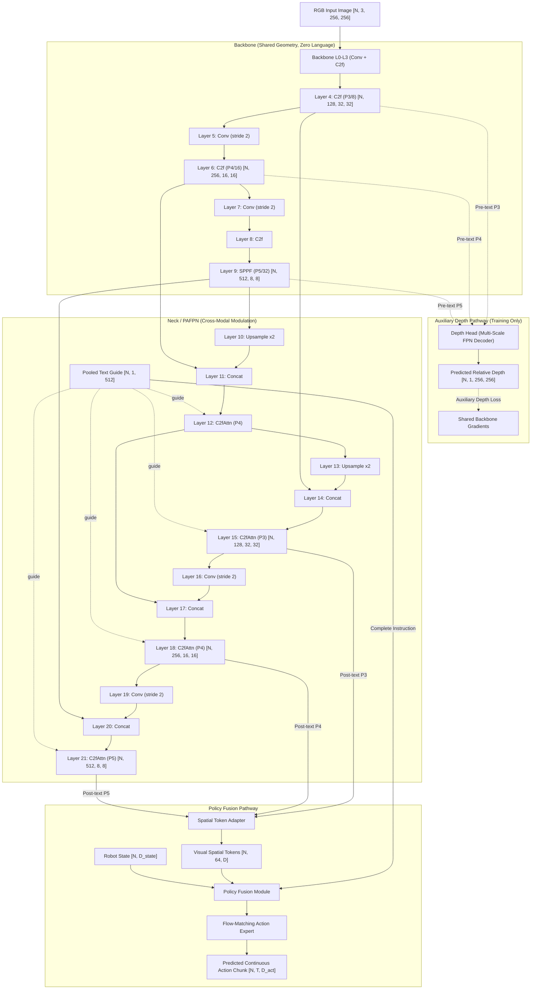

# YOLO-World Source Inspection & Architectural Integration Report

**Date / Timestamp:** 2026-10-26 16:15 UTC+1
**Target Workspace:** `/home/abolarinwa-sa/Documents/Smol-VLAxYOLO`
**Active Branch:** `architecture/yolo-world-policy`
**Pinned Upstream Repositories:**
- **Ultralytics YOLO-World:** `third_party/ultralytics`
  - **Git Commit SHA:** `aa1f778a75a610f7dd2aa4762df1c25f6a3063d7`
  - **Commit Subject:** `Fix duplicate detections in CoreML segmentation NMS exports (#26862)` (Sun Oct 25 14:52:03 2026 +0100)
  - **Package Version:** `8.4.189` ([ultralytics/__init__.py](file:///home/abolarinwa-sa/Documents/Smol-VLAxYOLO/third_party/ultralytics/ultralytics/__init__.py#L3))
  - **Key Files:** [yolov8-worldv2.yaml](file:///home/abolarinwa-sa/Documents/Smol-VLAxYOLO/third_party/ultralytics/ultralytics/cfg/models/v8/yolov8-worldv2.yaml), [tasks.py](file:///home/abolarinwa-sa/Documents/Smol-VLAxYOLO/third_party/ultralytics/ultralytics/nn/tasks.py), [block.py](file:///home/abolarinwa-sa/Documents/Smol-VLAxYOLO/third_party/ultralytics/ultralytics/nn/modules/block.py), [head.py](file:///home/abolarinwa-sa/Documents/Smol-VLAxYOLO/third_party/ultralytics/ultralytics/nn/modules/head.py), [text_model.py](file:///home/abolarinwa-sa/Documents/Smol-VLAxYOLO/third_party/ultralytics/ultralytics/nn/text_model.py)
- **AILab-CVC Official YOLO-World:** `third_party/yolo_world` ([yolo_world.py](file:///home/abolarinwa-sa/Documents/Smol-VLAxYOLO/third_party/yolo_world/yolo_world/models/detectors/yolo_world.py), [yolo_world_pafpn.py](file:///home/abolarinwa-sa/Documents/Smol-VLAxYOLO/third_party/yolo_world/yolo_world/models/necks/yolo_world_pafpn.py), [basic_requirements.txt](file:///home/abolarinwa-sa/Documents/Smol-VLAxYOLO/third_party/yolo_world/requirements/basic_requirements.txt))
- **Upstream LeRobot SmolVLA:** `third_party/lerobot` (Commit `d3793b7e36522321c1c455f0dc4826db3793dceb`, [modeling_smolvla.py](file:///home/abolarinwa-sa/Documents/Smol-VLAxYOLO/third_party/lerobot/src/lerobot/policies/smolvla/modeling_smolvla.py), [smolvlm_with_expert.py](file:///home/abolarinwa-sa/Documents/Smol-VLAxYOLO/third_party/lerobot/src/lerobot/policies/smolvla/smolvlm_with_expert.py))

---

## 1. Executive Summary

This report documents the architectural inspection of YOLO-World implementations for integration into the **Smol-VLAxYOLO Architecture v2** compact robot policy.

Key conclusions:
1. **Ultralytics YOLO-Worldv2 (`yolov8-worldv2.yaml`) is the selected foundation:** It uses pure PyTorch operations, eliminates the dynamic `ImagePoolingAttn` module present in v1, and avoids custom C++/CUDA kernel compilation.
2. **Clear Separation of Geometric vs. Language Features:** The CNN backbone (Layers 0–9) operates purely on RGB pixels with **zero language conditioning**, providing the exact tap points required for the **auxiliary depth head** to preserve relative spatial structure via shared gradients.
3. **Cross-Modal Neck as Token Source:** The PAFPN neck (Layers 10–21) incorporates text conditioning via `C2fAttn` and `MaxSigmoidAttnBlock`. Tapping Layers 15 (P3), 18 (P4), and 21 (P5) provides multi-scale, language-modulated visual representations for the **Spatial Token Adapter**.
4. **Dynamic Batching Feasibility:** While standard object detection relies on static offline class vocabulary expansion (`1, K, 512` broadcast to `B, K, 512`), the underlying tensor operations in `MaxSigmoidAttnBlock` natively support dynamic per-sample text conditioning (`N, 1, 512`) where each observation in a batch receives a distinct natural language task prompt.

---

## 2. Verified Model Graph & Dataflow

### 2.1 Layer Specification (`yolov8-worldv2.yaml`)

> [!IMPORTANT]
> The repeating unit counts ($n$) and channel arguments listed in the YAML configuration are **unscaled specifications**. During instantiation via `parse_model` in Ultralytics, they are dynamically scaled by compound factors ($d, w$). The table below explicitly distinguishes the unscaled YAML specifications from the instantiated values for the small model (`s`: depth $d=0.33$, width $w=0.50$, max channels $c_\text{max}=1024$).

| Layer Index | Module Type | Source Input (`from`) | Unscaled YAML $n$ / args | Instantiated Small (`s`) $n$ / Output Ch | Stride | Semantic Role / Tap Point |
|---|---|---|---|---|---|---|
| **0** | `Conv` | `-1` | $n=1$, `[64, 3, 2]` | $n=1$, 32 ch | 2 | P1/2 Stem downsample |
| **1** | `Conv` | `-1` | $n=1$, `[128, 3, 2]` | $n=1$, 64 ch | 4 | P2/4 Downsample |
| **2** | `C2f` | `-1` | $n=3$, `[128, True]` | $n=1$, 64 ch | 4 | P2/4 Feature refinement |
| **3** | `Conv` | `-1` | $n=1$, `[256, 3, 2]` | $n=1$, 128 ch | 8 | P3/8 Downsample |
| **4** | `C2f` | `-1` | $n=6$, `[256, True]` | $n=2$, 128 ch | 8 | **Backbone Stage 3 (P3/8)** — **Pre-text tap** |
| **5** | `Conv` | `-1` | $n=1$, `[512, 3, 2]` | $n=1$, 256 ch | 16 | P4/16 Downsample |
| **6** | `C2f` | `-1` | $n=6$, `[512, True]` | $n=2$, 256 ch | 16 | **Backbone Stage 4 (P4/16)** — **Pre-text tap** |
| **7** | `Conv` | `-1` | $n=1$, `[1024, 3, 2]` | $n=1$, 512 ch | 32 | P5/32 Downsample |
| **8** | `C2f` | `-1` | $n=3$, `[1024, True]` | $n=1$, 512 ch | 32 | P5/32 Feature refinement |
| **9** | `SPPF` | `-1` | $n=1$, `[1024, 5]` | $n=1$, 512 ch | 32 | **Backbone Stage 5 (P5/32)** — **Pre-text tap** |
| **10** | `nn.Upsample` | `-1` | $n=1$, `[None, 2, "nearest"]` | $n=1$, 512 ch | 16 | Top-down path upsample |
| **11** | `Concat` | `[-1, 6]` | $n=1$, `[1]` | $n=1$, 768 ch | 16 | Concat with Backbone Stage 4 (512+256) |
| **12** | `C2fAttn` | `-1` | $n=3$, `[512, 256, 8]` | $n=1$, 256 ch | 16 | Top-down P4 text cross-attention |
| **13** | `nn.Upsample` | `-1` | $n=1$, `[None, 2, "nearest"]` | $n=1$, 256 ch | 8 | Top-down path upsample |
| **14** | `Concat` | `[-1, 4]` | $n=1$, `[1]` | $n=1$, 384 ch | 8 | Concat with Backbone Stage 3 (256+128) |
| **15** | `C2fAttn` | `-1` | $n=3$, `[256, 128, 4]` | $n=1$, 128 ch | 8 | **Neck Stage 3 (P3/8)** — **Post-text tap** |
| **16** | `Conv` | `15` | $n=1$, `[256, 3, 2]` | $n=1$, 128 ch | 16 | Bottom-up path downsample (from L15) |
| **17** | `Concat` | `[-1, 12]` | $n=1$, `[1]` | $n=1$, 384 ch | 16 | Concat with Neck Stage 4 (128+256) |
| **18** | `C2fAttn` | `-1` | $n=3$, `[512, 256, 8]` | $n=1$, 256 ch | 16 | **Neck Stage 4 (P4/16)** — **Post-text tap** |
| **19** | `Conv` | `-1` | $n=1$, `[512, 3, 2]` | $n=1$, 256 ch | 32 | Bottom-up path downsample |
| **20** | `Concat` | `[-1, 9]` | $n=1$, `[1]` | $n=1$, 768 ch | 32 | Concat with Backbone Stage 5 (256+512) |
| **21** | `C2fAttn` | `-1` | $n=3$, `[1024, 512, 16]` | $n=1$, 512 ch | 32 | **Neck Stage 5 (P5/32)** — **Post-text tap** |
| **22** | `WorldDetect` | `[15, 18, 21]` | $n=1$, `[nc, 512, True]` | — | — | Detection Head *(Excluded from Extractor)* |

### 2.2 Compound Scaling & Upstream Figures

The compound scaling parameters defined in [yolov8-worldv2.yaml:9-16](file:///home/abolarinwa-sa/Documents/Smol-VLAxYOLO/third_party/ultralytics/ultralytics/cfg/models/v8/yolov8-worldv2.yaml#L9-L16) determine depth ($d$), width ($w$), and maximum channels ($c_\text{max}$):

| Scale | Depth Multiplier ($d$) | Width Multiplier ($w$) | Max Channels ($c_\text{max}$) | Backbone P3 / P4 / P5 Channels | Neck P3 / P4 / P5 Channels | Upstream Detector Figures (640×640) | Estimated Extractor-Only (256×256) |
|---|---|---|---|---|---|---|---|
| **n** (nano) | 0.33 | 0.25 | 1024 | 64 / 128 / 256 | 64 / 128 / 256 | 3.7M params / 19.5 GFLOPs | ~3.1M params / ~3.1 GFLOPs |
| **s** (small) | 0.33 | 0.50 | 1024 | 128 / 256 / 512 | 128 / 256 / 512 | 12.8M params / 51.0 GFLOPs | ~10.7M params / ~8.2 GFLOPs |
| **m** (medium) | 0.67 | 0.75 | 768 | 192 / 384 / 576 | 192 / 384 / 576 | 28.4M params / 110.5 GFLOPs | ~24.1M params / ~17.7 GFLOPs |
| **l** (large) | 1.00 | 1.00 | 512 | 256 / 512 / 512 | 256 / 512 / 512 | 46.8M params / 204.5 GFLOPs | ~39.8M params / ~32.7 GFLOPs |
| **x** (extra large)| 1.00 | 1.25 | 512 | 320 / 640 / 512 | 320 / 640 / 512 | 72.9M params / 309.3 GFLOPs | ~62.0M params / ~49.5 GFLOPs |

> [!NOTE]
> The parameter and FLOP numbers in the 640×640 column are upstream detector figures (including `WorldDetect` heads and anchor grids). The rightmost column gives rough estimates for modules 0..21 at policy image resolution (256×256). Actual runtime metrics on target edge devices (e.g. Jetson Orin Nano) remain to be measured empirically.

### 2.3 YOLO-Worldv1 vs. YOLO-Worldv2 Structural Comparison

Inspection of [yolov8-world.yaml](file:///home/abolarinwa-sa/Documents/Smol-VLAxYOLO/third_party/ultralytics/ultralytics/cfg/models/v8/yolov8-world.yaml) vs. [yolov8-worldv2.yaml](file:///home/abolarinwa-sa/Documents/Smol-VLAxYOLO/third_party/ultralytics/ultralytics/cfg/models/v8/yolov8-worldv2.yaml) reveals:
- **ImagePoolingAttn Removal:** v1 included an `ImagePoolingAttn` block at Layer 16 that extracted multi-scale visual tokens and updated the text feature embedding `txt_feats = m(x, txt_feats)` mid-network. v2 completely eliminates this module, keeping `txt_feats` immutable across all neck attention blocks.
- **Inference Efficiency:** Upstream detector benchmarks indicate FLOP reductions from 71.5 GFLOPs (v1-s) to 51.0 GFLOPs (v2-s). (Export and deployment compatibility for our customized sub-graph remains pending empirical validation).
- **Contrastive Head Normalization:** v2 sets `with_bn=True` on `WorldDetect`, replacing `ContrastiveHead` (L2 normalization) with `BNContrastiveHead` (BatchNorm2d), which offers superior training numerical stability ([head.py:980](file:///home/abolarinwa-sa/Documents/Smol-VLAxYOLO/third_party/ultralytics/ultralytics/nn/modules/head.py#L980)).

---

## 3. Feature Extraction Points & Flow Architecture



### 3.1 Pre-Text Extraction Points (Auxiliary Depth Head)

The auxiliary depth head operates under a strict **shared-gradient requirement**:
- **Source Layers:**
  - Layer 4 (`C2f`, P3/8): Resolution $H/8 \times W/8$, 128 channels (for 's').
  - Layer 6 (`C2f`, P4/16): Resolution $H/16 \times W/16$, 256 channels (for 's').
  - Layer 9 (`SPPF`, P5/32): Resolution $H/32 \times W/32$, 512 channels (for 's').
- **Architectural Rationale:**
  - Layers 0 through 9 contain **no text conditioning**. Depth represents the scene's relative spatial structure and geometry, which should remain invariant to the specific linguistic task instruction.
  - Gradients from the auxiliary depth supervision flow backward directly through Layers 9, 6, 4 down to Layer 0, encouraging the early CNN layers to preserve high-fidelity relative spatial structure.

### 3.2 Post-Text Extraction Points (Policy Spatial Token Adapter)

The Spatial Token Adapter requires visual representations that are already modulated by the linguistic context of the user task:
- **Source Layers:**
  - Layer 15 (`C2fAttn`, P3/8): Resolution $H/8 \times W/8$, 128 channels.
  - Layer 18 (`C2fAttn`, P4/16): Resolution $H/16 \times W/16$, 256 channels.
  - Layer 21 (`C2fAttn`, P5/32): Resolution $H/32 \times W/32$, 512 channels.
- **Modulation Mechanism ([block.py:604-619](file:///home/abolarinwa-sa/Documents/Smol-VLAxYOLO/third_party/ultralytics/ultralytics/nn/modules/block.py#L604-L619)):**
  - Text features `guide` pass through linear projection `self.gl(guide)`.
  - Visual embedding `embed` is projected via `self.ec(x)`.
  - Attention affinity: $\text{aw} = \sigma\left(\frac{\max(\text{embed} \cdot \text{guide}^T)}{\sqrt{c}} + \text{bias}\right) \cdot \text{scale}$.
  - Visual feature channels are spatially modulated: $x = \text{proj}(x) \odot \text{aw}$.
- **Output:** The spatial regions corresponding to objects or task-relevant entities mentioned in `guide` have amplified activations before spatial pooling.

---

## 4. Text Batching Contract & Cross-Modal Attention

### 4.1 Upstream YOLO-World Paradigm vs. Robot Policy Paradigm

| Property | Standard YOLO-World (Ultralytics / MMYOLO) | Robot Policy (Smol-VLAxYOLO) |
|---|---|---|
| **Prompt Type** | Fixed category names (e.g., `["sponge", "cup", "table"]`) | Natural language instructions (e.g., `"pick up yellow sponge"`) |
| **Vocabulary Mutability** | Offline / Static across dataset evaluation | Dynamic / Per-sample online conditioning |
| **Batch Dimension** | Broadcast from shape `(1, K, 512)` to `(N, K, 512)` | Natively batched: sample $i$ has instruction $i$ in `(N, 1, 512)` |
| **Pretrained Compatibility** | Pretrained on pooled L2-normalized class embeddings | **Requires single pooled embedding `[N, 1, 512]`** |
| **Direct Policy Fusion** | None (detection scores output directly from head) | **Mandatory:** Complete text embedding also enters policy fusion directly |

> [!CAUTION]
> **Pretrained Guide Compatibility:** YOLO-World was pretrained with pooled, single-vector-per-class text embeddings produced by CLIP's text projection head (e.g., shape `[1, num_classes, 512]`). Supplying 77 unpooled raw token embeddings (`[N, 77, 512]`) alters the attention geometry in `(embed @ guide).max(dim=-1)` and is **not** a drop-in pretrained-compatible substitute. For zero-shot visual feature modulation using pretrained weights, the input text guide must be a single pooled, L2-normalized embedding vector of shape `[N, 1, 512]`.

### 4.2 Verified Attention Tensor Operations

Inspection of `MaxSigmoidAttnBlock.forward` ([block.py:594-620](file:///home/abolarinwa-sa/Documents/Smol-VLAxYOLO/third_party/ultralytics/ultralytics/nn/modules/block.py#L594-L620)) verifies native batch support:

```python
def forward(self, x: torch.Tensor, guide: torch.Tensor) -> torch.Tensor:
    bs, _, h, w = x.shape

    guide = self.gl(guide)
    guide = guide.view(bs, guide.shape[1], self.nh, self.hc)
    embed = self.ec(x) if self.ec is not None else x
    embed = embed.view(bs, self.nh, self.hc, h, w)

    aw = (embed.flatten(3).transpose(2, 3) @ guide.permute(0, 2, 3, 1)).max(dim=-1)[0].view(bs, self.nh, h, w)
    aw = aw / (self.hc**0.5)
    aw = aw + self.bias[None, :, None, None]
    aw = aw.sigmoid() * self.scale

    x = self.proj_conv(x)
    x = x.view(bs, self.nh, -1, h, w)
    x = x * aw.unsqueeze(2)
    return x.view(bs, -1, h, w)
```

**Key Verification:**
1. **Batch Compatibility:** When `guide.shape[0] == x.shape[0]`, the batch matrix multiplication operates parallel without broadcasting.
2. **Dimension Constraints:**
   - Visual tensor `x`: `[N, C_in, H, W]`
   - Text guide `guide`: `[N, 1, 512]` where `guide_channels (gc) = 512`
   - Projection dimension `ec = 128`
   - Heads `nh`: 2 for P3, 4 for P4, 8 for P5 (in small model `s`)
3. **Data Type Preservation:** All operations utilize standard PyTorch tensor math and remain compatible with mixed precision (`torch.autocast`).

---

## 5. Dependency Findings & Framework Selection

### 5.1 Comparison: Ultralytics vs. AILab-CVC (MMYOLO)

| Evaluation Metric | Ultralytics YOLO-World | AILab-CVC YOLO-World |
|---|---|---|
| **Underlying Framework** | Pure PyTorch (`torch.nn.Module`) | OpenMMLab (`mmcv`, `mmdet`, `mmyolo`, `mmengine`) |
| **C++/CUDA Extensions** | **None** (zero compilation required) | **Heavy** (`mmcv` custom C++/CUDA ops) |
| **Edge Portability (Jetson)** | High: runs on stock PyTorch wheels | Low: requires custom source build of MMCV for JetPack |
| **Model Customization** | Modular YAML or direct programmatic composition | Complex configuration dictionaries and registries |
| **PyTorch 2.x Compatibility** | Fully verified and stable | Frequent breakage with newer PyTorch / CUDA versions |
| **Text Model Decoupling** | Text encoding separated in `text_model.py` | Embedded inside MMDetection data preprocessors |

### 5.2 Text Encoder Ecosystem Integration

Ultralytics provides a wrapper in [text_model.py:46-130](file:///home/abolarinwa-sa/Documents/Smol-VLAxYOLO/third_party/ultralytics/ultralytics/nn/text_model.py#L46-L130) that loads `clip:ViT-B/32` via `git+https://github.com/ultralytics/CLIP.git`.

For `smol_vla_mod`, using Hugging Face `transformers` (`CLIPTextModelWithProjection.from_pretrained("openai/clip-vit-base-patch32")`) is proposed to avoid git-url dependencies.
> [!NOTE]
> Exact numerical parity between Hugging Face `transformers` CLIP projection outputs and OpenAI CLIP / Ultralytics CLIP remains **pending numerical verification** on remote compute.

---

## 6. Verification Records & Local Command History

To maintain complete audit integrity, all local verification attempts and their actual outcomes are recorded below:

| Attempted Command | Scope | Actual Exit Code & Outcome | Status |
|---|---|---|---|
| `git -C third_party/ultralytics rev-parse HEAD` | Pinned source check | Exit 0: `aa1f778a75a610f7dd2aa4762df1c25f6a3063d7` | **Verified** |
| `python3 -c "import tomllib; ..."` | `pyproject.toml` syntax check | Exit 0: Parsed valid TOML (`smol-vla-mod 0.2.0.dev0`) | **Verified** |
| `python3 -m unittest discover tests` | Unit test execution | Exit 1: `ImportError / Skipped: PyTorch is not installed locally; numerical tests run on Kaggle.` | **Documented (Local non-PyTorch environment)** |
| `pytest` | Test suite execution | Exit 5: `0 items collected / 1 skipped in 0.12s` | **Documented (Local non-PyTorch environment)** |
| `python3 -c "import smol_vla_mod.vision ..."` | Package import check | Exit 1: `ModuleNotFoundError: No module named 'torch'` (due to Phase 1 `yolo_tokenizer.py`) | **Documented (Local non-PyTorch environment)** |

> [!WARNING]
> **No Numerical Validation Locally:** The local development environment strictly avoids heavyweight dependencies (`torch`, `ultralytics`, `transformers`). A zero-test run or skipped suite does NOT constitute numerical validation. All tensor forward passes, gradient flows, and numerical tolerances are marked **unverified locally** and must be validated on GPU compute (Kaggle).

---

## 7. Current `pyproject.toml` Contents

Below is the verified content of [pyproject.toml](file:///home/abolarinwa-sa/Documents/Smol-VLAxYOLO/pyproject.toml):

```toml
[build-system]
requires = ["setuptools>=61.0"]
build-backend = "setuptools.build_meta"

[project]
name = "smol-vla-mod"
version = "0.2.0.dev0"
description = "Lightweight language-conditioned robot policy with YOLO-World visual pathway, direct instruction fusion, and auxiliary depth supervision."
readme = "README.md"
requires-python = ">=3.10"
# NOTE: This pyproject.toml provides packaging scaffolding for the src-layout repository.
# It explicitly avoids speculative ML dependency pins or lockfiles; full runtime environments
# (PyTorch, Ultralytics, Transformers, LeRobot, etc.) are provisioned on remote compute
# (e.g., Kaggle GPU environments) or edge deployment hardware (Jetson Orin Nano).

[tool.setuptools.packages.find]
where = ["src"]

[tool.pytest.ini_options]
pythonpath = ["src"]
testpaths = ["tests"]
markers = [
    "adapter_only: tests specific to the SpatialTokenAdapter module",
    "yolo_backbone: tests using synthetic or mock YOLO backbones",
    "real_yolo: tests requiring the real Ultralytics YOLO package",
    "cuda: tests requiring CUDA device availability",
]
```
